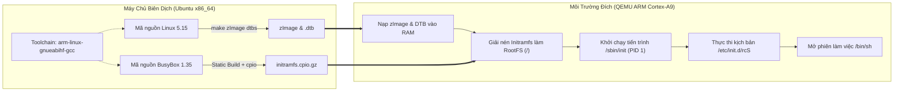

# embedded-linux-lab_1
# Đồ Án Thực Hành 01: Xây Dựng Hệ Điều Hành Linux Nhúng Từ Nguồn (ARM Cortex-A9)

> **Họ và tên sinh viên:** Nguyễn Minh Hải  
> **Nền tảng mục tiêu:** Bo mạch ARM Versatile Express (`vexpress-a9`)  
> **Công cụ biên dịch chéo:** `arm-linux-gnueabihf-` (GCC 13.3.0 trên Ubuntu)  

---

## 1. Giới Thiệu Đề Tài

Bài thực hành số 1 giải quyết bài toán cốt lõi trong kỹ thuật hệ thống nhúng: **Tự đóng gói một bản phân phối Linux tối giản từ mã nguồn gốc (From Scratch)** cho kiến trúc vi xử lý ARM 32-bit mà không phụ thuộc vào các hệ điều hành dựng sẵn.

Toàn bộ các thành phần từ Bộ nạp khởi động (U-Boot), Nhân hệ điều hành (Linux Kernel 5.15), Cây thiết bị phần cứng (Device Tree) cho đến Hệ thống tệp gốc (Initramfs tích hợp BusyBox) đều được biên dịch chéo trên máy chủ Ubuntu và kiểm thử trực tiếp trên trình mô phỏng phần cứng QEMU.

---

## 2. Sơ Đồ Quy Trình Tích Hợp & Khởi Động

Khác với máy tính cá nhân thông thường, hệ thống nhúng ARM nạp trực tiếp ảnh nhân và hệ thống tệp nén vào bộ nhớ RAM thông qua các địa chỉ vật lý được định nghĩa trong Device Tree:



---

## 3. Đặc Tả Kỹ Thuật Hệ Thống

* **Kiến trúc tập lệnh:** ARMv7-A (Hỗ trợ tập lệnh phần cứng dấu chấm động VFPv3).
* **Thông số phần cứng giả lập:** 2 nhân CPU Cortex-A9 (SMP), bộ nhớ RAM 512 MB, cổng giao tiếp nối tiếp `ttyAMA0` (tốc độ truyền 115200 baud).
* **Cơ chế lưu trữ RootFS:** Sử dụng `initramfs` (nén định dạng `cpio.gz`), giúp toàn bộ hệ thống tệp gốc chạy trực tiếp trên RAM với tốc độ truy xuất tức thời.
* **Phương thức liên kết thư viện:** BusyBox được biên dịch ở chế độ liên kết tĩnh (`CONFIG_STATIC=y`), loại bỏ hoàn toàn sự phụ thuộc vào các tệp thư viện động `.so` trong giai đoạn khởi động sớm.

---

## 4. Tổ Chức Thư Mục Dự Án

```text
lab01-embedded-linux/
├── configs/                  # Lưu trữ cấu hình biên dịch của Kernel và BusyBox
├── output/                   # Chứa các tệp nhị phân thực thi sau biên dịch
│   ├── zImage                # Ảnh nhân Linux đã nén cho ARM
│   ├── vexpress-v2p-ca9.dtb  # Tệp mô tả phần cứng bo mạch Versatile Express
│   ├── u-boot                # Bộ nạp khởi động U-Boot
│   └── initramfs.cpio.gz     # Hệ thống tệp gốc đóng gói
├── rootfs/                   # Cây thư mục gốc trước khi đóng gói
│   └── initramfs/
│       ├── bin/ & sbin/      # Các liên kết mềm (symlinks) trỏ về busybox
│       ├── etc/init.d/rcS    # Kịch bản tự động thiết lập môi trường khi boot
│       ├── etc/inittab       # Cấu hình luồng điều khiển cho tiến trình init
│       └── dev, proc, sys    # Các điểm gắn kết (mount points) hệ thống
└── README.md                 # Tài liệu báo cáo kỹ thuật
```

---

## 5. Nhật Ký Triển Khai & Lệnh Thực Thi

### Bước 1: Thiết lập công cụ biên dịch chéo trên Ubuntu
Cài đặt bộ công cụ biên dịch chéo dành riêng cho kiến trúc ARM hard-float cùng các thư viện phục vụ quá trình xây dựng nhân:
```bash
sudo apt update
sudo apt install -y gcc-arm-linux-gnueabihf binutils-arm-linux-gnueabihf \
    build-essential libncurses-dev bison flex libssl-dev libelf-dev \
    qemu-system-arm cpio
```

### Bước 2: Biên dịch Nhân Linux 5.15 & Device Tree
Sử dụng cấu hình chuẩn của dòng bo mạch `vexpress` và biên dịch song song trên đa luồng CPU:
```bash
cd ~/embedded_lab1/kernel/linux-5.15
make ARCH=arm CROSS_COMPILE=arm-linux-gnueabihf- vexpress_defconfig
make -j$(nproc) ARCH=arm CROSS_COMPILE=arm-linux-gnueabihf- zImage dtbs modules

cp arch/arm/boot/zImage ~/embedded_lab1/output/
cp arch/arm/boot/dts/vexpress-v2p-ca9.dtb ~/embedded_lab1/output/
```

### Bước 3: Biên dịch U-Boot 2022.04
```bash
cd ~/embedded_lab1/uboot/u-boot-2022.04
make ARCH=arm CROSS_COMPILE=arm-linux-gnueabihf- vexpress_ca9x4_defconfig
make -j$(nproc) ARCH=arm CROSS_COMPILE=arm-linux-gnueabihf-
cp u-boot ~/embedded_lab1/output/
```

### Bước 4: Xây dựng Không gian người dùng (BusyBox) & Đóng gói Initramfs
Sau khi biên dịch tĩnh BusyBox và cài đặt vào `rootfs/initramfs`, kịch bản `/etc/init.d/rcS` được thiết lập để tự động gắn kết các hệ thống tệp ảo của nhân:
```sh
#!/bin/sh
mount -t proc none /proc
mount -t sysfs none /sys
mount -t tmpfs none /tmp
mount -t devtmpfs none /dev 2>/dev/null || true

[ -c /dev/console ] || mknod /dev/console c 5 1
[ -c /dev/null    ] || mknod /dev/null c 1 3
[ -c /dev/zero    ] || mknod /dev/zero c 1 5

hostname embedded-lab1
echo "He thong Embedded Linux LAB-01 da khoi dong thanh cong!"
```

Lệnh đóng gói cây thư mục thành ảnh nén `initramfs.cpio.gz`:
```bash
cd ~/embedded_lab1/rootfs/initramfs
find . | cpio -H newc -o | gzip > ~/embedded_lab1/output/initramfs.cpio.gz
```

---

## 6. Kiểm Thử Vận Hành Trên QEMU

Khởi chạy máy ảo ARM với các thành phần đã biên dịch:
```bash
qemu-system-arm \
  -M vexpress-a9 -cpu cortex-a9 -m 512M -smp 2 -nographic \
  -kernel ~/embedded_lab1/output/zImage \
  -dtb ~/embedded_lab1/output/vexpress-v2p-ca9.dtb \
  -initrd ~/embedded_lab1/output/initramfs.cpio.gz \
  -append "console=ttyAMA0,115200 rdinit=/sbin/init mem=512M"
```

### Kết quả kiểm tra thực tế trong giao diện điều khiển BusyBox (`/#`):
* **Kiểm tra thông tin nhân (`uname -a`):** Xác nhận nhân Linux 5.15.0 SMP chạy trên kiến trúc `armv7l`.
* **Kiểm tra bảng gắn kết (`mount`):** Các hệ thống tệp ảo `/proc`, `/sys`, `/tmp` đã được gắn kết tự động đúng như kịch bản `rcS`.
* **Kiểm tra tiến trình (`ps`):** Tiến trình `/sbin/init` hoạt động với `PID 1` và quản lý phiên làm việc `/bin/sh`.

---

## 7. Tổng Kết Đánh Giá

| Hạng mục công việc | Trạng thái | Ghi chú kết quả |
| :--- | :---: | :--- |
| Cài đặt Toolchain `arm-linux-gnueabihf` | Hoàn thành | Biên dịch chéo thành công các mã nguồn sang ARM 32-bit |
| Biên dịch Linux Kernel 5.15 (`zImage` & `.dtb`) | Hoàn thành | Nhân khởi động mượt mà, nhận diện đủ 2 CPU và 512MB RAM |
| Biên dịch U-Boot 2022.04 | Hoàn thành | Tạo tệp thực thi `u-boot` chuẩn bo mạch `vexpress_ca9x4` |
| Đóng gói RootFS (`initramfs.cpio.gz`) | Hoàn thành | Tích hợp BusyBox tĩnh và kịch bản tự động hóa `rcS` |
| Khởi chạy và tương tác trên QEMU | Hoàn thành | Truy cập thành công shell `/#` qua cổng nối tiếp `ttyAMA0` |
