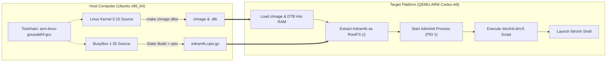

# Embedded Linux Lab 1: Building an Embedded Linux System from Source (ARM Cortex-A9)

**Student Name:** Nguyễn Minh Hải  
**Target Platform:** ARM Versatile Express Board (`vexpress-a9`)  
**Cross-Compilation Toolchain:** `arm-linux-gnueabihf-` (GCC 13.3.0 on Ubuntu)

---

## 1. Introduction

Embedded Linux Lab 1 focuses on one of the fundamental tasks in embedded systems engineering: **building a minimal Linux operating system from scratch** for a 32-bit ARM processor without using a pre-built Linux distribution.

The system consists of several important components, including the U-Boot bootloader, Linux Kernel 5.15, Device Tree, and an Initramfs root filesystem integrated with BusyBox.

All components are cross-compiled on an Ubuntu host computer and tested using the QEMU hardware emulator.

The main objective of this lab is to understand how an embedded Linux system is built, configured, and booted on an ARM Cortex-A9 platform.

---

## 2. System Integration and Boot Process

Unlike traditional personal computers, embedded ARM systems can load the Linux kernel image and compressed root filesystem directly into RAM.

The following diagram illustrates the compilation and boot process.



The boot process consists of the following stages:

1. The Linux kernel image and Device Tree are loaded into memory.
2. The kernel initializes the ARM hardware and system resources.
3. The Initramfs archive is extracted and used as the root filesystem.
4. The `/sbin/init` process starts as PID 1.
5. The `/etc/init.d/rcS` script configures the system environment.
6. The BusyBox shell becomes available for user interaction.

---

## 3. System Technical Specifications

The embedded Linux system uses the following hardware and software configuration.

- **Processor Architecture:** ARMv7-A, supporting VFPv3 hardware floating-point instructions.
- **Target CPU:** ARM Cortex-A9.
- **CPU Configuration:** 2 Cortex-A9 CPU cores with SMP support.
- **Memory:** 512 MB RAM.
- **Serial Communication:** `ttyAMA0` at 115200 baud.
- **Linux Kernel Version:** 5.15.
- **Bootloader:** U-Boot 2022.04.
- **User-Space Utilities:** BusyBox 1.35.0.
- **Root Filesystem:** Initramfs compressed using the `cpio.gz` format.
- **Emulation Platform:** QEMU ARM System Emulator.
- **Cross-Compilation Toolchain:** `arm-linux-gnueabihf-`.

The root filesystem is stored in RAM using Initramfs, allowing the system to operate without a physical storage device.

BusyBox is compiled using static linking (`CONFIG_STATIC=y`). This reduces dependencies on external shared libraries (`.so`) during the early boot process.

---

## 4. Project Directory Structure

The project is organized into separate directories for source configurations, compiled files, and the root filesystem.

```text
lab01-embedded-linux/
├── configs/                  # Kernel and BusyBox build configurations
├── output/                   # Compiled binary files
│   ├── zImage                # Compressed ARM Linux kernel image
│   ├── vexpress-v2p-ca9.dtb  # Versatile Express Device Tree Blob
│   ├── u-boot                # U-Boot bootloader binary
│   └── initramfs.cpio.gz     # Compressed root filesystem
├── rootfs/                   # Root filesystem directory
│   └── initramfs/
│       ├── bin/ & sbin/      # BusyBox commands and symbolic links
│       ├── etc/init.d/rcS    # System initialization script
│       ├── etc/inittab       # Init process configuration
│       └── dev, proc, sys    # System mount points
└── README.md                 # Technical documentation
```

Each directory has a specific purpose.

The `configs` directory stores configuration files used during compilation.

The `output` directory contains the compiled kernel image, Device Tree, bootloader, and Initramfs archive.

The `rootfs` directory contains the filesystem structure that will be packaged into Initramfs.

---

## 5. Implementation Steps and Commands

### Step 1: Installing the Cross-Compilation Toolchain on Ubuntu

The first step is to install the ARM cross-compilation toolchain and the packages required to build the Linux kernel and other system components.

Run the following commands in the Ubuntu terminal:

```bash
sudo apt update
sudo apt install -y gcc-arm-linux-gnueabihf binutils-arm-linux-gnueabihf \
    build-essential libncurses-dev bison flex libssl-dev libelf-dev \
    qemu-system-arm cpio
```

The `gcc-arm-linux-gnueabihf` package provides the compiler needed to build ARM applications on an x86_64 Ubuntu computer.

The `qemu-system-arm` package provides the emulator used to test the embedded Linux system.

Other packages provide the tools and libraries required for compilation.

### Step 2: Compiling Linux Kernel 5.15 and Device Tree

The Linux kernel is responsible for managing hardware resources, memory, processes, and device drivers.

First, navigate to the Linux kernel source directory.

```bash
cd ~/embedded_lab1/kernel/linux-5.15
```

Load the default configuration for the ARM Versatile Express platform.

```bash
make ARCH=arm CROSS_COMPILE=arm-linux-gnueabihf- vexpress_defconfig
```

Next, compile the kernel image, Device Tree files, and kernel modules.

```bash
make -j$(nproc) ARCH=arm CROSS_COMPILE=arm-linux-gnueabihf- zImage dtbs modules
```

The `-j$(nproc)` option enables parallel compilation using the available CPU cores.

After compilation, copy the required files to the output directory.

```bash
cp arch/arm/boot/zImage ~/embedded_lab1/output/
cp arch/arm/boot/dts/vexpress-v2p-ca9.dtb ~/embedded_lab1/output/
```

The generated files include:

- `zImage`: The compressed ARM Linux kernel image.
- `vexpress-v2p-ca9.dtb`: The Device Tree Blob containing hardware information for the target platform.

### Step 3: Compiling U-Boot 2022.04

U-Boot is a bootloader commonly used in embedded Linux systems.

Its main purpose is to initialize hardware and load the operating system kernel into memory.

Navigate to the U-Boot source directory.

```bash
cd ~/embedded_lab1/uboot/u-boot-2022.04
```

Load the configuration for the ARM Versatile Express Cortex-A9 platform.

```bash
make ARCH=arm CROSS_COMPILE=arm-linux-gnueabihf- vexpress_ca9x4_defconfig
```

Compile U-Boot.

```bash
make -j$(nproc) ARCH=arm CROSS_COMPILE=arm-linux-gnueabihf-
```

Copy the compiled bootloader to the output directory.

```bash
cp u-boot ~/embedded_lab1/output/
```

The output file `u-boot` can be used as a bootloader for the supported target platform.

### Step 4: Building BusyBox and Creating Initramfs

BusyBox provides a collection of essential Linux commands in a single executable file.

It is suitable for embedded systems because it requires fewer resources than a complete desktop Linux environment.

In this project, BusyBox is statically compiled and installed into the Initramfs filesystem.

The system initialization script is located at:

```text
/etc/init.d/rcS
```

This script automatically mounts the required virtual filesystems during system startup.

```sh
#!/bin/sh

mount -t proc none /proc
mount -t sysfs none /sys
mount -t tmpfs none /tmp
mount -t devtmpfs none /dev 2>/dev/null || true

[ -c /dev/console ] || mknod /dev/console c 5 1
[ -c /dev/null    ] || mknod /dev/null c 1 3
[ -c /dev/zero    ] || mknod /dev/zero c 1 5

hostname embedded-lab1

echo "Embedded Linux LAB-01 system booted successfully!"
```

The script performs several important tasks.

- Mounts `/proc` to provide information about kernel processes.
- Mounts `/sys` to provide access to system and device information.
- Mounts `/tmp` as temporary storage in RAM.
- Mounts `/dev` to provide access to device files.
- Creates essential device nodes if they do not exist.
- Sets the system hostname to `embedded-lab1`.
- Displays a successful startup message.

After configuring the root filesystem, package it into a compressed Initramfs archive.

```bash
cd ~/embedded_lab1/rootfs/initramfs

find . | cpio -H newc -o | gzip > ~/embedded_lab1/output/initramfs.cpio.gz
```

The generated `initramfs.cpio.gz` file contains the root filesystem needed during Linux startup.

---

## 6. Testing the Embedded Linux System Using QEMU

After compiling the required components, the embedded Linux system can be tested using QEMU.

The following command starts the ARM Cortex-A9 virtual machine.

```bash
qemu-system-arm \
  -M vexpress-a9 -cpu cortex-a9 -m 512M -smp 2 -nographic \
  -kernel ~/embedded_lab1/output/zImage \
  -dtb ~/embedded_lab1/output/vexpress-v2p-ca9.dtb \
  -initrd ~/embedded_lab1/output/initramfs.cpio.gz \
  -append "console=ttyAMA0,115200 rdinit=/sbin/init mem=512M"
```

The main QEMU parameters are explained below.

| Parameter | Description |
|---|---|
| `-M vexpress-a9` | Selects the ARM Versatile Express board |
| `-cpu cortex-a9` | Selects the ARM Cortex-A9 CPU |
| `-m 512M` | Allocates 512 MB of RAM |
| `-smp 2` | Configures two virtual CPU cores |
| `-nographic` | Uses the terminal instead of a graphical interface |
| `-kernel` | Loads the Linux kernel image |
| `-dtb` | Loads the Device Tree Blob |
| `-initrd` | Loads the compressed Initramfs archive |
| `-append` | Passes boot parameters to the Linux kernel |

### Testing Results

After the system boots successfully, the BusyBox shell should appear with a prompt similar to:

```text
/ #
```

Several Linux commands can be used to verify system operation.

**1. Checking the Linux Kernel Version**

```bash
uname -a
```

Expected result:

The command displays Linux kernel information, including version 5.15.0 and the ARMv7 architecture.

**2. Checking Mounted Filesystems**

```bash
mount
```

Expected result:

The command displays the mounted filesystems, including `/proc`, `/sys`, and `/tmp`.

These filesystems are configured automatically by the `rcS` initialization script.

**3. Checking Running Processes**

```bash
ps
```

Expected result:

The command displays active system processes.

The `/sbin/init` process runs as PID 1 and manages the initialization of the system.

The `/bin/sh` process provides the interactive command-line environment.

These tests help verify that the Linux kernel, root filesystem, and BusyBox environment are functioning correctly.

---

## 7. Results and Evaluation

The following table summarizes the implementation results of Embedded Linux Lab 1.

| Task | Status | Result |
|---|---|---|
| Install ARM Cross-Compilation Toolchain | Completed | Successfully configured the ARM 32-bit compilation environment |
| Compile Linux Kernel 5.15 | Completed | Generated the ARM kernel image (`zImage`) and Device Tree Blob (`.dtb`) |
| Compile U-Boot 2022.04 | Completed | Generated the U-Boot executable for the `vexpress_ca9x4` platform |
| Build BusyBox Root Filesystem | Completed | Integrated statically linked BusyBox and the `rcS` initialization script |
| Create Initramfs Archive | Completed | Generated the compressed `initramfs.cpio.gz` archive |
| Test Linux Using QEMU | Completed | Booted the system and accessed the BusyBox shell through `ttyAMA0` |

### Conclusion

In Embedded Linux Lab 1, a minimal embedded Linux system was built from source code for the ARM Cortex-A9 platform.

The implementation involved installing the cross-compilation toolchain, compiling Linux Kernel 5.15, building U-Boot 2022.04, creating a BusyBox-based root filesystem, and packaging it into an Initramfs archive.

The system was designed to run on the QEMU Versatile Express ARM platform with two Cortex-A9 CPU cores and 512 MB of RAM.

This lab provides practical knowledge of embedded Linux development, including cross-compilation, kernel configuration, bootloaders, root filesystem creation, system initialization, and QEMU emulation.

**Overall, Embedded Linux Lab 1 demonstrates the basic process of building and testing a minimal Linux operating system for an ARM-based embedded platform.**
